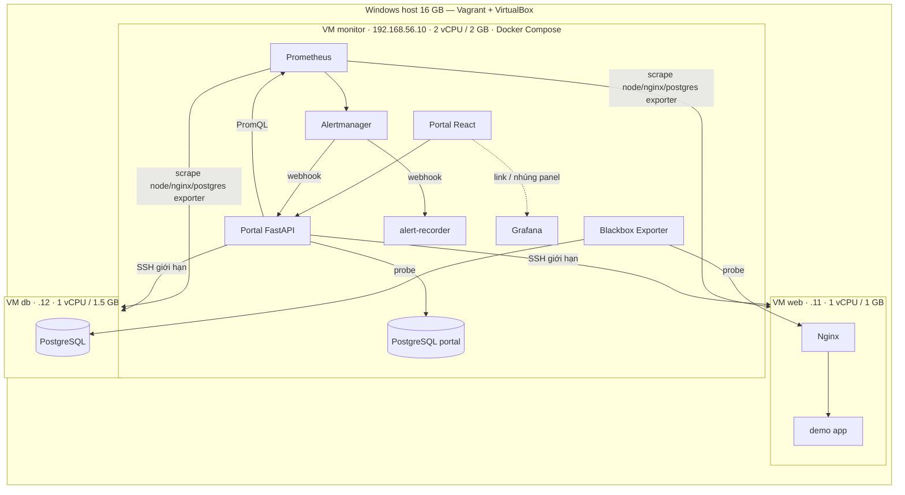

# Infra Observability Lab

Prototype hệ thống giám sát máy chủ/dịch vụ trên môi trường lab gồm **3 máy ảo** (Vagrant + VirtualBox),
kèm **web portal** do nhóm tự phát triển để quản lý cảnh báo, sự cố và kịch bản lỗi.
Đề tài N4.7 — xem [de-tai.md](de-tai.md).

> **Trạng thái:** xong **giai đoạn 2**: `vagrant up` dựng 3 VM và lõi giám sát (Prometheus, Alertmanager, Grafana,
> Blackbox, alert-recorder, exporter cho host/Nginx/PostgreSQL, 13 luật cảnh báo, 5 dashboard, runbook nháp).
> Kịch bản lỗi và đo baseline: giai đoạn 3.
>
> ```powershell
> vagrant up                                               # cần ~6.5 GB RAM trống
> python tools/check_lab.py --wait 180 --test-alert        # mọi target UP, Grafana có dữ liệu, cảnh báo thử OK
> start http://localhost:3000                              # Grafana (xem ẩn danh; admin trong .env)
> ```
> Tiến độ và tiêu chí từng giai đoạn: [docs/lo-trinh.md](docs/lo-trinh.md).

## Kiến trúc



Mỗi VM đều chạy Node Exporter. Chi tiết và lý do lựa chọn: [docs/02-thiet-ke/adr/](docs/02-thiet-ke/adr/).

## Cấu trúc thư mục

| Thư mục | Nội dung | Giai đoạn |
|---|---|---|
| `Vagrantfile`, `provision/` | Định nghĩa 3 VM và script cài đặt (shell) | 1 |
| `monitor/` | Compose cho VM monitor: Prometheus (luật, **ngưỡng**), Alertmanager, Blackbox, Grafana, alert-recorder | 2 |
| `apps/demo-web/` | Ứng dụng web demo chạy sau Nginx trên VM web | 1–2 |
| `faults/` | Script gây lỗi chạy **trên VM** (CPU, disk, dừng service, độ trễ) | 3 |
| `tools/` | CLI chạy trên Windows: kiểm tra lab, đo baseline, tính thời gian phát hiện, reload cấu hình | 2–3 |
| `runbooks/` | Hướng dẫn xử lý từng cảnh báo (một nguồn duy nhất, portal nạp vào) | 2–3 |
| `portal/` | Web portal: `backend/` (FastAPI) + `frontend/` (React + Vite) | 5–7 |
| `docs/` | Tài liệu báo cáo: phân tích → thiết kế → hiện thực → triển khai → thử nghiệm | mọi GĐ |
| `data/`, `results/` | Dữ liệu sinh khi chạy và kết quả đo (không commit) | — |

## Nguyên tắc

- **Không đặt ngưỡng tuỳ ý:** ngưỡng nằm ở `monitor/prometheus/rules/thresholds.yml`, mang trạng thái
  `provisional` cho tới khi nhóm đo baseline và chốt (ADR-0004).
- **Không credential thật:** chỉ có `.env.example`; `.env` và `.lab-keys/` bị gitignore.
- **Không kết nối hệ thống thật:** mọi thứ nằm trong mạng host-only 192.168.56.0/24.
- **Dựng lại được:** `vagrant destroy -f && vagrant up` phải tái tạo toàn bộ lab.

## Tài liệu

Mục lục: [docs/README.md](docs/README.md).
