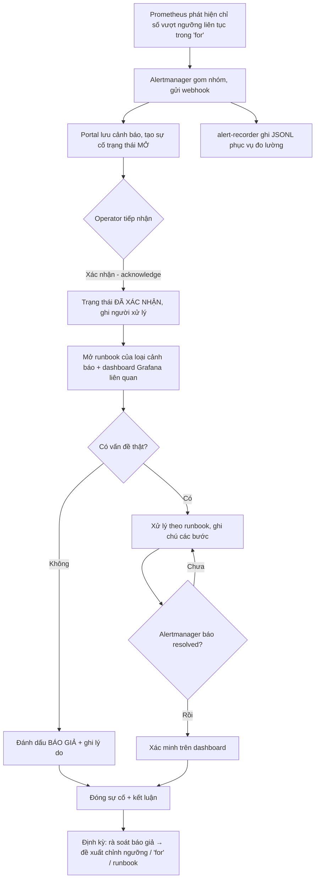
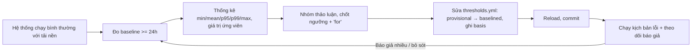
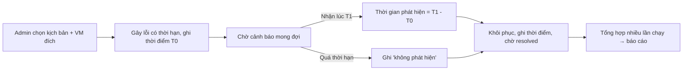

# Phân tích nghiệp vụ

> Trạng thái: **bản nháp GĐ0** — nhóm đọc và góp ý trước khi sang GĐ4 (thiết kế portal).

## 1. Bối cảnh và vấn đề

Nhóm vận hành một môi trường lab gồm vài máy chủ (web, CSDL, giám sát). Hiện trạng thường gặp ở các lab nhỏ:

| Vấn đề | Hệ quả |
|---|---|
| Không có cái nhìn thống nhất về sức khỏe các máy/dịch vụ | Phải SSH vào từng máy để kiểm tra; phát hiện sự cố khi người dùng báo |
| Không có ngưỡng cảnh báo có căn cứ | Hoặc báo quá nhiều (báo giả, "mệt mỏi cảnh báo"), hoặc bỏ sót sự cố |
| Cảnh báo không được theo dõi tới khi xử lý xong | Không biết ai đang xử lý, đã xử lý thế nào, có phải báo giả không |
| Không có hướng dẫn xử lý | Mỗi lần sự cố lại phải tự mò; người mới không xử lý được |
| Không đo được hiệu quả giám sát | Không trả lời được "mất bao lâu để phát hiện sự cố?" |

**Mục tiêu nghiệp vụ** (theo [đề tài](../../de-tai.md)): thu thập metric sức khỏe, dashboard thống nhất theo
host/service, cảnh báo ngưỡng có thể kiểm thử, quy trình xử lý cảnh báo có runbook và phân biệt báo giả, mô phỏng
lỗi và **đo thời gian phát hiện**. Đây là prototype trong môi trường kiểm soát, **không** thay thế NOC/DCIM thật.

## 2. Phạm vi

**Trong phạm vi**
- 3 VM lab (monitor, web, db) do nhóm quản lý; metric CPU, RAM, disk, network, uptime, endpoint, Nginx, PostgreSQL.
- Cảnh báo ngưỡng (Prometheus/Alertmanager) với ngưỡng chốt sau baseline.
- Web portal: tổng quan, chi tiết, quản lý host/service, xử lý cảnh báo/sự cố, runbook, chạy kịch bản lỗi, báo cáo.
- Grafana cho phân tích chuyên sâu.

**Ngoài phạm vi**
- Kết nối hệ thống/trung tâm dữ liệu thật, dữ liệu nhạy cảm, credential sản xuất.
- Gửi thông báo ra kênh bên ngoài (email, SMS, chat) — có thể mô phỏng sau.
- Phát hiện bất thường bằng học máy (NAB) — hướng mở rộng tuỳ chọn.
- Thu thập và phân tích log tập trung.

## 3. Thuật ngữ

| Thuật ngữ | Định nghĩa trong dự án |
|---|---|
| **Host** | Một máy (VM) được giám sát: monitor, web, db |
| **Service** | Một dịch vụ chạy trên host và có thể kiểm tra được: Nginx, demo app, PostgreSQL, ... |
| **Target** | Một endpoint mà Prometheus scrape hoặc Blackbox probe |
| **Metric** | Chuỗi số đo theo thời gian (vd. % CPU) |
| **Ngưỡng (threshold)** | Giá trị giới hạn mà khi chỉ số vượt qua liên tục trong khoảng `for` thì sinh cảnh báo |
| **Baseline** | Thống kê chỉ số khi hệ thống chạy bình thường, dùng làm căn cứ chọn ngưỡng |
| **Cảnh báo (alert)** | Một lần luật cảnh báo kích hoạt cho một đối tượng cụ thể, định danh bằng *fingerprint* của Alertmanager; từ lúc *firing* tới *resolved* là một **đợt** (episode) |
| **Sự cố (incident)** | Hồ sơ xử lý do operator quản lý; được tạo từ một đợt cảnh báo, có thể gom thêm các cảnh báo liên quan. Có trạng thái xử lý riêng (mở → đã xác nhận → đã đóng) |
| **Báo giả (false positive)** | Cảnh báo kích hoạt khi không có vấn đề thật cần xử lý (vd. tải đột biến ngắn hợp lệ, ngưỡng quá thấp, lỗi của chính hệ thống giám sát) |
| **Runbook** | Hướng dẫn xử lý cho một loại cảnh báo: ý nghĩa, cách kiểm tra, cách xử lý, cách nhận diện báo giả |
| **Kịch bản lỗi (fault scenario)** | Thao tác có kiểm soát, có thời hạn, gây ra một lỗi giả lập trên VM (CPU cao, disk đầy, dừng service, ...) |
| **Thời gian phát hiện** | Thời điểm hệ thống nhận cảnh báo (firing) − thời điểm gây lỗi |

> Câu hỏi mở cho GĐ4: phiên bản đầu dùng quan hệ **1 đợt cảnh báo ↔ 1 sự cố** (tự tạo), cho phép operator gộp
> thủ công. Có cần tự động gộp (vd. cùng host trong 5 phút) không?

## 4. Quy trình nghiệp vụ

### 4.1 Xử lý cảnh báo (to-be)

Quy tắc nghiệp vụ:
- **BR-01** Trạng thái của Alertmanager (*firing/resolved*) và trạng thái xử lý (*mở/đã xác nhận/đã đóng*) độc lập:
  cảnh báo có thể *resolved* mà sự cố chưa đóng (chưa có kết luận), và ngược lại không được đóng sự cố khi cảnh
  báo còn *firing*, trừ khi đánh dấu báo giả.
- **BR-02** Mỗi thao tác (xác nhận, ghi chú, đánh dấu báo giả, đóng) lưu người thực hiện và thời điểm.
- **BR-03** Cảnh báo cùng fingerprint kích hoạt lại sau khi đã *resolved* là **đợt mới**.
- **BR-04** Đánh dấu báo giả bắt buộc có lý do (phục vụ rà soát ngưỡng).

### 4.2 Chốt ngưỡng dựa trên baseline

### 4.3 Thử nghiệm kịch bản lỗi

- **BR-05** Chỉ **admin** được chạy kịch bản lỗi; mỗi lần chạy có thời hạn tối đa và tự khôi phục.
- **BR-06** Không chạy hai kịch bản đồng thời trên cùng một VM (kết quả đo bị nhiễu).
- **BR-07** Thời gian phát hiện chịu cận dưới bởi cấu hình (scrape interval + evaluation interval + `for` +
  `group_wait`); báo cáo phải ghi rõ các giá trị này.
