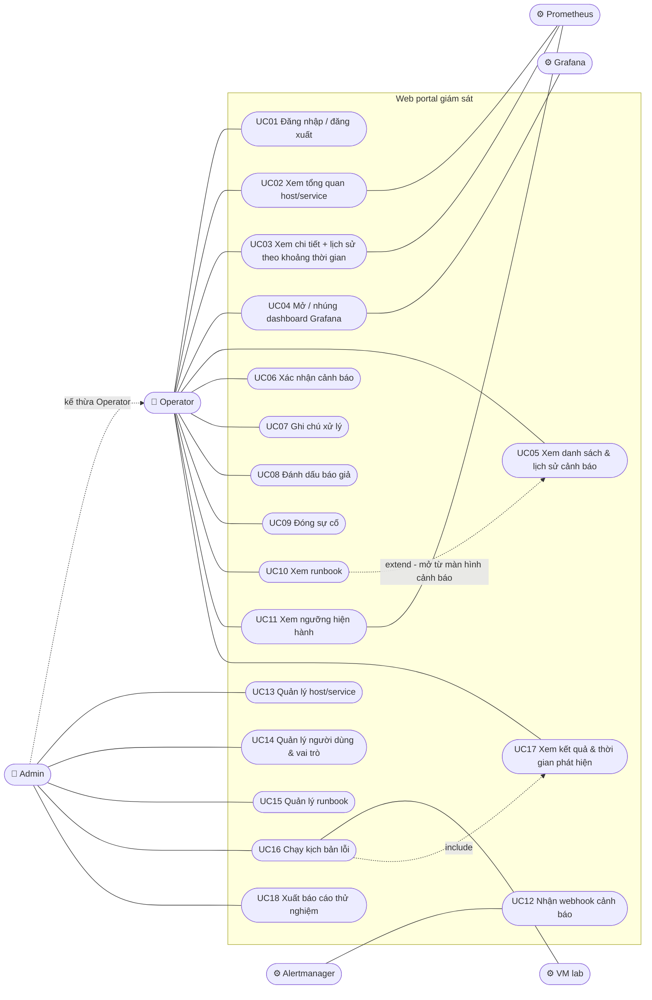

# Tác nhân và use case

> Trạng thái: **bản nháp GĐ0**. Đặc tả chi tiết (luồng chính/phụ) cho các use case mức **M** sẽ bổ sung ở GĐ4.

## 1. Tác nhân

| Tác nhân | Loại | Mô tả |
|---|---|---|
| **Operator** | Người | Người trực vận hành: theo dõi tổng quan, tiếp nhận và xử lý cảnh báo/sự cố, đọc runbook |
| **Admin** | Người | Kế thừa mọi quyền của Operator; quản lý người dùng, host/service, runbook; **chạy kịch bản lỗi**, xuất báo cáo thử nghiệm |
| **Alertmanager** | Hệ thống | Gửi webhook cảnh báo (firing/resolved) tới portal |
| **Prometheus** | Hệ thống | Cung cấp metric hiện tại và lịch sử qua HTTP API |
| **VM lab (web, db)** | Hệ thống | Nhận lệnh gây lỗi/khôi phục qua SSH bị giới hạn (ADR-0007) |
| **Grafana** | Hệ thống | Hiển thị dashboard chuyên sâu, được portal link hoặc nhúng |

## 2. Sơ đồ use case

## 3. Danh sách use case

| Mã | Use case | Tác nhân chính | Ưu tiên* | Ghi chú |
|---|---|---|---|---|
| UC01 | Đăng nhập / đăng xuất | Operator, Admin | M | JWT, phân quyền phía server |
| UC02 | Xem tổng quan | Operator | M | Trạng thái UP/DOWN, CPU/RAM/disk/network hiện tại, số cảnh báo đang mở |
| UC03 | Xem chi tiết host/service | Operator | M | Biểu đồ lịch sử, chọn khoảng thời gian, cảnh báo liên quan |
| UC04 | Mở/nhúng Grafana | Operator | S | Link kèm biến + khoảng thời gian; nhúng panel `d-solo` |
| UC05 | Xem danh sách & lịch sử cảnh báo | Operator | M | Lọc theo trạng thái, mức độ, host/service, thời gian |
| UC06 | Xác nhận cảnh báo | Operator | M | Ghi người xác nhận + thời điểm |
| UC07 | Ghi chú xử lý | Operator | M | Nhiều ghi chú theo thời gian |
| UC08 | Đánh dấu báo giả | Operator | M | Bắt buộc lý do (BR-04) |
| UC09 | Đóng sự cố | Operator | M | Kiểm tra BR-01 |
| UC10 | Xem runbook | Operator | M | Tự gắn theo `alertname` |
| UC11 | Xem ngưỡng hiện hành | Operator | S | Đọc `lab:threshold:*`, hiển thị trạng thái provisional/baselined |
| UC12 | Nhận webhook cảnh báo | Alertmanager | M | Idempotent, xác thực bằng token chia sẻ |
| UC13 | Quản lý host/service | Admin | M | Danh sách đối tượng hiển thị trên portal, ánh xạ tới nhãn Prometheus |
| UC14 | Quản lý người dùng & vai trò | Admin | S | Tối thiểu: tạo/khoá tài khoản, gán vai trò |
| UC15 | Quản lý runbook | Admin | C | Phiên bản đầu nạp từ `runbooks/*.md`; sửa trên UI để sau |
| UC16 | Chạy kịch bản lỗi | Admin | M | CPU cao, disk đầy, dừng service; có thời hạn; BR-05, BR-06 |
| UC17 | Xem kết quả & thời gian phát hiện | Operator, Admin | M | Tự khớp cảnh báo với lần chạy |
| UC18 | Xuất báo cáo thử nghiệm | Admin | S | CSV + Markdown |

\* MoSCoW: **M** = phải có, **S** = nên có, **C** = có thì tốt. Nếu trễ tiến độ, cắt từ C rồi tới S.
