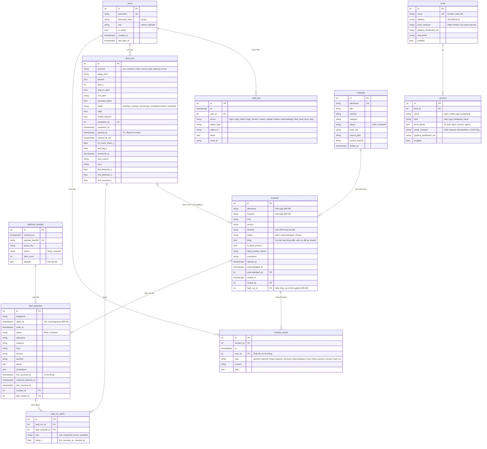
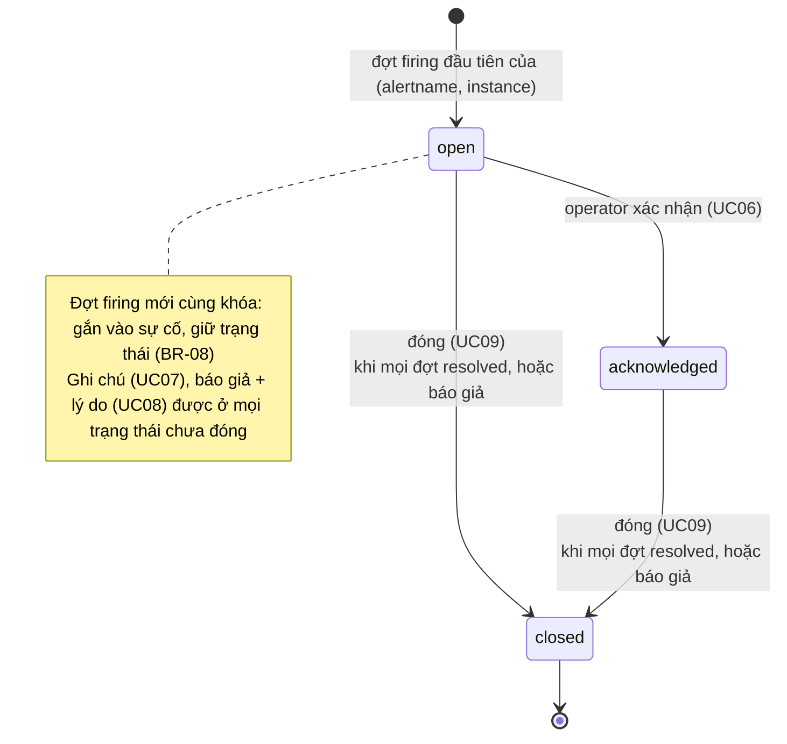
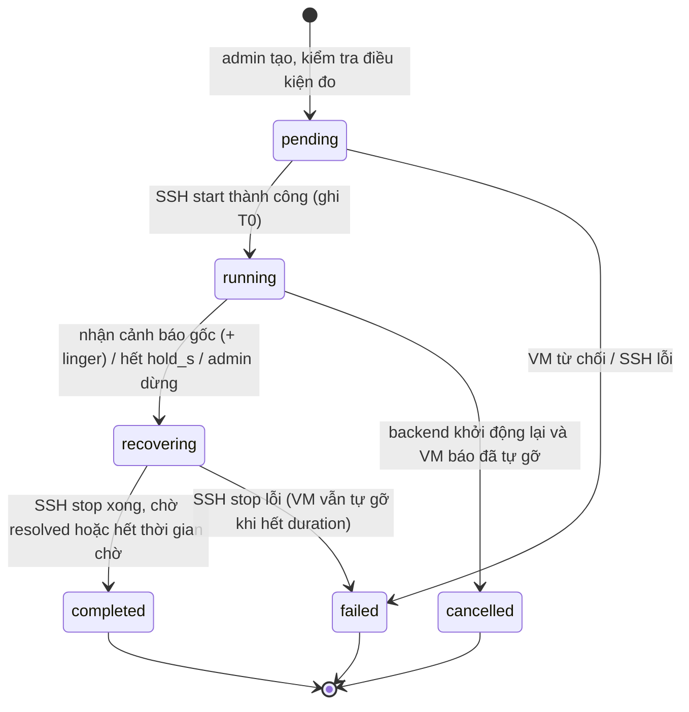

# Mô hình dữ liệu portal (ERD)

> GĐ4, phần 1. CSDL: PostgreSQL riêng của portal (ADR-0005); test trên Windows dùng SQLite cùng mô hình.
> Kiến trúc: [kien-truc-portal.md](kien-truc-portal.md). Mọi cột thời gian là `timestamptz` UTC, độ chính xác mili-giây (NFR-08).

## Ràng buộc và chỉ mục

| Bảng | Ràng buộc | Nguồn |
|---|---|---|
| `alert_episodes` | `UNIQUE (fingerprint, starts_at)` | BR-03, NFR-06 |
| `incidents` | `UNIQUE (alertname, instance) WHERE status <> 'closed'`: tối đa một sự cố chưa đóng mỗi khóa | BR-08 |
| `incidents` | `CHECK (status <> 'closed' OR NOT firing OR is_false_positive)`: không đóng khi còn firing, trừ báo giả | BR-01 |
| `incidents` | `CHECK (NOT is_false_positive OR length(false_positive_reason) > 0)` | BR-04 |
| `incidents` | `fault_run_id` FK `fault_runs`, có chỉ mục: lọc và loại sự cố thử nghiệm | BR-09 |
| `fault_runs` | `UNIQUE (target_host) WHERE status IN ('pending','running','recovering')`: mỗi VM một lần chạy | BR-06 |
| `webhook_receipts` | `UNIQUE (payload_sha256)`: Alertmanager gửi lại y hệt thì bỏ qua | NFR-06 |
| `services` | `UNIQUE (host_id, name)` | UC13 |
| Chỉ mục | `incidents (status, opened_at)`, `alert_episodes (host, first_received_at)`, `audit_log (at)` | lọc, phân trang, khớp kịch bản |

Các kiểm tra trên **cũng** nằm ở tầng service để trả lỗi rõ (409/422); ràng buộc CSDL là lớp chặn cuối khi có tranh chấp
(hai webhook tới cùng lúc, hai admin cùng bấm chạy).

## Máy trạng thái sự cố

Trạng thái xử lý (`status`) và trạng thái Alertmanager (`firing`) độc lập (BR-01). Sự cố đã đóng không mở lại; đợt firing
sau đó tạo sự cố mới.

## Vòng đời lần chạy kịch bản lỗi

## Sự cố thử nghiệm (BR-09)

Khi webhook mang một đợt firing mới và đợt đó khớp một lần chạy đang hoạt động với vai trò `root`, `expected` hoặc `extra`
(xem `fault_run_alerts.role`; `unrelated` không tính), sự cố chứa đợt đó được gắn nhãn thử nghiệm:

- `incidents.fault_run_id` = lần chạy đầu tiên khớp (không ghi đè nếu sau đó lần chạy khác cũng rơi vào sự cố này).
- Thêm một dòng `incident_events` loại `fault_run` (người thực hiện rỗng = hệ thống), nội dung
  "Do kịch bản lỗi #N (…) gây ra lúc T0"; `data` giữ `fault_run_id`, `case`, `scenario`, `target_host`, `injected_at`, `role`,
  `episode_id`. Mỗi (sự cố, lần chạy) chỉ một dòng dù có nhiều đợt.
- **Không** đổi `status` hay `is_false_positive`: đây là phát hiện đúng, operator vẫn xử lý và đóng như sự cố thường.
- Báo cáo tỉ lệ báo giả loại sự cố thử nghiệm khỏi cả tử số và mẫu số.

Nhãn chỉ được gắn khi đợt cảnh báo tới (không quét lại sự cố cũ). Đợt tới trước T0 − 2 s không khớp nên sự cố thật có sẵn
từ trước khi chạy kịch bản không bị gắn nhầm.

Khi backend khởi động, mọi lần chạy ở `pending/running/recovering` được kiểm tra lại bằng SSH `status`: VM vẫn đang lỗi thì
gỡ (`stop`), đã tự gỡ thì đánh dấu `cancelled` và `valid=false` (NFR-07).

## Không lưu trong CSDL

- Metric, ngưỡng (`lab:threshold:*`): đọc trực tiếp từ Prometheus khi cần.
- Payload JSONL của alert-recorder: nguồn đối chứng riêng (ADR-0006).
