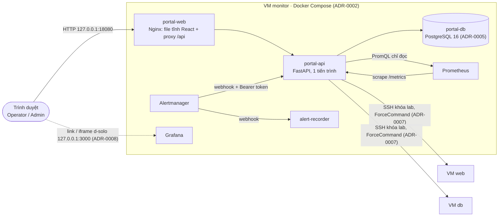

# Kiến trúc web portal (GĐ4, phần 1)

> Trạng thái: **thiết kế GĐ4, chờ mentor duyệt**. Truy vết tới [use case](../01-phan-tich/use-case.md), [yêu cầu](../01-phan-tich/yeu-cau.md)
> (FR-P, NFR) và quy tắc nghiệp vụ BR-01…BR-08 trong [nghiệp vụ](../01-phan-tich/nghiep-vu.md). Dữ liệu: [erd.md](erd.md).
> Không có wireframe ([ADR-0009](adr/0009-bo-wireframe-gd4.md)); định hướng giao diện: [giao-dien.md](giao-dien.md).

## 1. Bối cảnh và ranh giới



- Portal là **công cụ xử lý cảnh báo** và **công cụ chạy thử nghiệm**. Nó không thay Prometheus, Alertmanager hay Grafana:
  không tự đánh giá ngưỡng, không gửi thông báo ra ngoài, không vẽ dashboard chuyên sâu.
- Nguồn sự thật: metric và ngưỡng ở **Prometheus** (portal chỉ đọc); vòng đời cảnh báo và sự cố, người dùng, lần chạy kịch
  bản ở **portal-db**; nội dung runbook ở **`runbooks/*.md` trong git** (portal nạp vào CSDL để tìm kiếm và hiển thị).
- alert-recorder vẫn nhận webhook song song và là đối chứng độc lập cho thời gian phát hiện (ADR-0006).

## 2. Thành phần

| Container | Ảnh / công nghệ | Cổng | Vai trò |
|---|---|---|---|
| `portal-web` | `nginx:1.27-alpine` + bản build React (Vite, TypeScript) | 8080 trong VM → `127.0.0.1:18080` trên Windows | Phục vụ SPA; proxy `/api/*` tới `portal-api`; không có logic |
| `portal-api` | Python 3.12, FastAPI, SQLAlchemy 2, Alembic, Pydantic 2, uvicorn | 8000 (chỉ mạng Compose) | REST API, xác thực, phân quyền, nhận webhook, đọc Prometheus, chạy kịch bản lỗi, tính thời gian phát hiện, xuất báo cáo, `/metrics` (NFR-13) |
| `portal-db` | `postgres:16-alpine`, volume riêng | 5432 (chỉ mạng Compose) | CSDL portal |

`portal-api` chạy **một tiến trình uvicorn**: tác vụ nền (theo dõi lần chạy kịch bản, nạp runbook) chạy trong cùng event
loop, không cần hàng đợi riêng. Đủ cho lab 3 VM và vài người dùng; trạng thái lưu trong CSDL nên khởi động lại không mất.

### Mô-đun backend

```
portal/backend/app/
  main.py            tạo app, gắn router, tác vụ nền lúc khởi động (bootstrap admin, nạp runbook, khôi phục lần chạy dở)
  core/              config (.env), security (bcrypt, JWT), deps (người dùng hiện tại, yêu cầu vai trò), clock
  db/                engine, session, base; models/ (SQLAlchemy); migrations/ (Alembic)
  schemas/           Pydantic cho request/response
  api/               auth, users, hosts, services, overview, metrics, alerts, incidents, runbooks, thresholds,
                     faults, reports, webhooks, audit
  services/
    alert_ingest.py  webhook → đợt cảnh báo → sự cố (BR-03, BR-08), idempotent (NFR-06)
    incidents.py     chuyển trạng thái xử lý, kiểm tra BR-01/BR-04, dòng thời gian
    prometheus.py    client PromQL chỉ đọc, timeout, bộ nhớ đệm ngắn
    runbooks.py      đọc runbooks/*.md (front matter + nội dung)
    fault_runner.py  gọi obslab-fault qua SSH, vòng đời lần chạy, tự khôi phục
    detection.py     khớp cảnh báo với lần chạy, tính thời gian phát hiện (cùng thuật toán tools/detection_time.py)
    reports.py       CSV + Markdown
    audit.py
```

Frontend (`portal/frontend/src/`): `api/` (client fetch có token), `pages/` theo màn hình (mục 5), `components/`, `routes/`
(chặn route theo vai trò; chỉ để ẩn giao diện, quyền thật kiểm ở backend).

## 3. Quyết định chính

| Chủ đề | Thiết kế | Lý do / yêu cầu |
|---|---|---|
| Xác thực | Đăng nhập username + mật khẩu → JWT HS256, hạn `PORTAL_JWT_EXPIRE_MINUTES` (60). Gửi trong header `Authorization: Bearer`. SPA giữ token trong bộ nhớ + `sessionStorage` (đóng tab là mất). Không refresh token: hết hạn thì đăng nhập lại | FR-P01, NFR-02. Header thay cho cookie nên không cần chống CSRF |
| Mật khẩu | bcrypt (cost 12). Admin đầu tiên tạo từ `PORTAL_BOOTSTRAP_ADMIN_*` khi bảng `users` rỗng | NFR-02 |
| Phân quyền | 2 vai trò `admin` ⊃ `operator`. Mỗi endpoint khai báo vai trò tối thiểu bằng dependency; thiếu quyền → 403. Tài khoản bị khóa → 401 dù token còn hạn (kiểm tra mỗi request) | FR-P02, NFR-03 |
| Webhook | `POST /api/webhooks/alertmanager`, token chia sẻ `PORTAL_WEBHOOK_TOKEN` (biến mới) qua `http_config.authorization` của Alertmanager; sai/thiếu → 401. Lưu payload thô trước, xử lý sau trong cùng transaction | NFR-05, NFR-06 |
| Idempotent | Đợt cảnh báo định danh bằng `(fingerprint, starts_at)` (BR-03), có ràng buộc unique. Gửi lặp chỉ cập nhật `last_received_at`, không tạo bản ghi mới | NFR-06 |
| Sự cố | Khóa `(alertname, instance)`; tối đa **một** sự cố chưa đóng mỗi khóa (unique index có điều kiện). Đợt firing mới gắn vào sự cố đang mở, nếu không có thì tạo sự cố mới (BR-08). Sự cố đã đóng không mở lại | BR-08 |
| Đọc Prometheus | Backend làm proxy có danh sách truy vấn dựng sẵn; client chỉ gửi tham số (host, khoảng thời gian), **không** gửi PromQL tùy ý. Timeout 5 s, cache 15 s theo truy vấn, giới hạn tối đa 11.000 điểm/series | An toàn, nhẹ cho Prometheus |
| Kịch bản lỗi | Backend gọi `obslab-fault` qua SSH (OpenSSH client như `tools/lib/faultssh.py`), khóa và `known_hosts` từ `.lab-keys/` (mount chỉ đọc). Chỉ admin; tham số kiểm ở backend **và** trên VM; mỗi VM tối đa một lần chạy đang hoạt động (unique index có điều kiện + VM tự từ chối). VM tự gỡ khi hết `duration` (ADR-0007), backend gỡ sớm khi đã nhận cảnh báo gốc | FR-P13, BR-05, BR-06, NFR-04, NFR-07 |
| Mốc thời gian | Mọi mốc lưu UTC, tới mili-giây (`timestamptz`). T0 = `started_ts` do VM trả về, hiệu chỉnh theo độ lệch đồng hồ VM↔monitor đọc từ Prometheus. T1 = lúc backend nhận webhook (đồng hồ monitor). Cùng nguồn đồng hồ với alert-recorder nên đối chiếu được ở GĐ7 | NFR-08, ADR-0006 |
| Điều kiện đo | Trước khi gây lỗi, backend kiểm tra như `fault.py`: không có lần chạy khác trên VM, không có cảnh báo đang firing của VM, độ trễ đánh giá luật ≤ 1 s (SC-04), đồng hồ VM ổn định. Lần chạy vẫn được phép khi không đạt nhưng bị đánh dấu `valid=false` kèm lý do | Kết quả đáng tin như CLI |
| Runbook | Nạp `runbooks/*.md` lúc khởi động và khi admin bấm "nạp lại"; khóa theo `alertname` trong front matter. Sửa trên UI (FR-P18, C) để sau | FR-P11 |
| Audit | Ghi `audit_log` cho mọi thao tác thay đổi dữ liệu, đăng nhập (thành công/thất bại) và chạy/dừng kịch bản | FR-P17, ADR-0007 |
| Lỗi API | JSON thống nhất `{"error": {"code", "message", "details"}}`; danh sách phân trang `{"items", "total", "page", "page_size"}` | [Thiết kế API](api/README.md) |
| Giao diện | Tiếng Việt, màn hình ≥ 1366 px; giờ hiển thị theo múi giờ trình duyệt, API luôn trả UTC ISO-8601 | NFR-14 |

## 4. Luồng dữ liệu chính

1. **Cảnh báo** (UC12, FR-P08): Alertmanager gửi payload nhóm theo `[alertname, instance, service]` → backend lưu
   `webhook_receipts` → với mỗi alert: tìm hoặc tạo `alert_episodes` → nếu `firing` và chưa gắn sự cố thì gắn hoặc tạo
   `incidents` → nếu có lần chạy kịch bản đang hoạt động trên host đó thì `detection` khớp và ghi `fault_run_alerts` → nếu
   `resolved` thì đóng đợt và ghi dòng thời gian của sự cố. Chi tiết: [sơ đồ tuần tự](so-do-tuan-tu.md).
2. **Xử lý sự cố** (UC05–UC09): operator xác nhận → ghi chú → (báo giả + lý do) hoặc chờ resolved → đóng kèm kết luận.
   Máy trạng thái ở [erd.md](erd.md#máy-trạng-thái-sự-cố).
3. **Tổng quan / chi tiết** (UC02, UC03, UC11): backend gọi Prometheus theo danh sách truy vấn dựng sẵn, ghép với danh mục
   host/service trong CSDL và số sự cố đang mở.
4. **Kịch bản lỗi** (UC16–UC18): admin tạo lần chạy → backend kiểm tra điều kiện → SSH `start` → theo dõi → nhận cảnh báo gốc
   (hoặc hết thời gian) → SSH `stop` → chờ resolved → tính kết quả → báo cáo.

## 5. Màn hình (thay cho wireframe)

| Màn hình | Vai trò | Nội dung | UC / FR |
|---|---|---|---|
| Đăng nhập | – | Form username/mật khẩu, thông báo lỗi chung (không lộ tài khoản có tồn tại hay không) | UC01 |
| Tổng quan | operator | Thẻ mỗi host: UP/DOWN, CPU/RAM/đĩa/mạng hiện tại, dịch vụ con và trạng thái; số sự cố đang mở theo mức độ; danh sách sự cố mới nhất | UC02, FR-P03 |
| Chi tiết host/service | operator | Biểu đồ lịch sử (15m, 1h, 6h, 24h, 7d, tùy chọn), đường ngưỡng; sự cố liên quan; nút mở Grafana; panel nhúng (S) | UC03, UC04, FR-P04–06 |
| Cảnh báo & sự cố | operator | Bảng sự cố có lọc (trạng thái xử lý, firing/resolved, mức độ, host, alertname, thời gian) và phân trang | UC05, FR-P09 |
| Chi tiết sự cố | operator | Thông tin, các đợt cảnh báo, dòng thời gian, nút xác nhận / ghi chú / báo giả / đóng; runbook hiển thị bên cạnh | UC06–UC10, FR-P10–11 |
| Runbook | operator | Danh sách + nội dung Markdown | UC10 |
| Ngưỡng | operator | Bảng `lab:threshold:*`, giá trị, trạng thái provisional/baselined, basis | UC11, FR-P12 |
| Kịch bản lỗi | admin (xem: operator) | Form chạy (kịch bản, VM, tham số trong giới hạn, thời hạn); lần chạy đang hoạt động; lịch sử với thời gian phát hiện; xuất CSV/Markdown | UC16–UC18, FR-P13–15 |
| Quản trị | admin | Host/service (CRUD, ánh xạ nhãn Prometheus, dashboard Grafana); người dùng (tạo, khóa, đổi vai trò); nhật ký thao tác | UC13, UC14, FR-P07, FR-P16–17 |

## 6. Cấu hình

Thêm vào `.env.example` khi hiện thực (giá trị giả):

| Biến | Ví dụ | Ghi chú |
|---|---|---|
| `PORTAL_DB_PASSWORD`, `PORTAL_JWT_SECRET`, `PORTAL_JWT_EXPIRE_MINUTES`, `PORTAL_BOOTSTRAP_ADMIN_*` | đã có | |
| `PORTAL_WEBHOOK_TOKEN` | `change-me-lab-only` | Alertmanager và portal cùng đọc |
| `PORTAL_FAULT_MAX_DURATION_S` | `840` | ≤ giới hạn 900 s của `obslab-fault` trừ biên an toàn |
| `PORTAL_SEED_INVENTORY` | `true` | Nạp 3 VM mẫu khi bảng hosts trống |
| `PORTAL_PROMETHEUS_URL`, `PORTAL_GRAFANA_PUBLIC_URL` | `http://prometheus:9090`, `http://localhost:3000` | URL trong mạng Compose và URL trình duyệt mở |

## 7. Phát triển và kiểm thử trên Windows

- Backend chạy được không cần lab: `DATABASE_URL=sqlite:///...` cho phát triển và test; model chỉ dùng kiểu chung
  (JSON, DateTime có múi giờ, unique index có điều kiện đều có ở cả SQLite và PostgreSQL). Prometheus, SSH và đồng hồ là
  interface, test thay bằng bản giả.
- Test tự động: pytest + `httpx` (TestClient) cho API; Vitest + Testing Library cho frontend; payload webhook mẫu lấy từ
  dữ liệu thật của alert-recorder (`docs/05-thu-nghiem/du-lieu/`).
- **Rủi ro:** khác biệt SQLite/PostgreSQL. Giảm bằng cách chạy lại toàn bộ test với PostgreSQL trong container khi triển khai
  lên VM monitor (sau baseline).

## 8. Bảo mật và hạn chế

- Cổng portal chỉ bind `127.0.0.1` trên Windows (như Grafana/Prometheus). Không có HTTPS trong lab; môi trường thật cần TLS.
- Backend không có shell tới VM: SSH chỉ chạy được wrapper với danh sách lệnh cho phép (ADR-0007); backend kiểm tham số
  trước để báo lỗi sớm và rõ.
- Không lộ PromQL tùy ý, không lộ đường dẫn file; Markdown runbook được render phía client có lọc HTML.
- Đăng nhập sai nhiều lần: ghi audit và chậm phản hồi (1 s); không khóa tài khoản tự động (tránh tự khóa admin trong lab).
- Hạn chế đã biết: JWT không thu hồi được trước khi hết hạn (khóa tài khoản có hiệu lực ngay nhờ kiểm tra mỗi request,
  nhưng đổi vai trò cũng vậy); Grafana ngoài phân quyền portal (ADR-0008).
