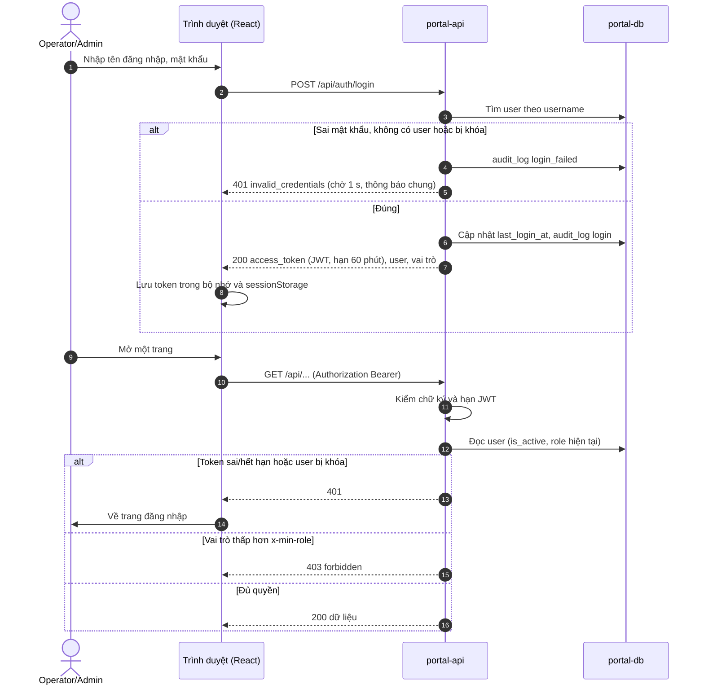
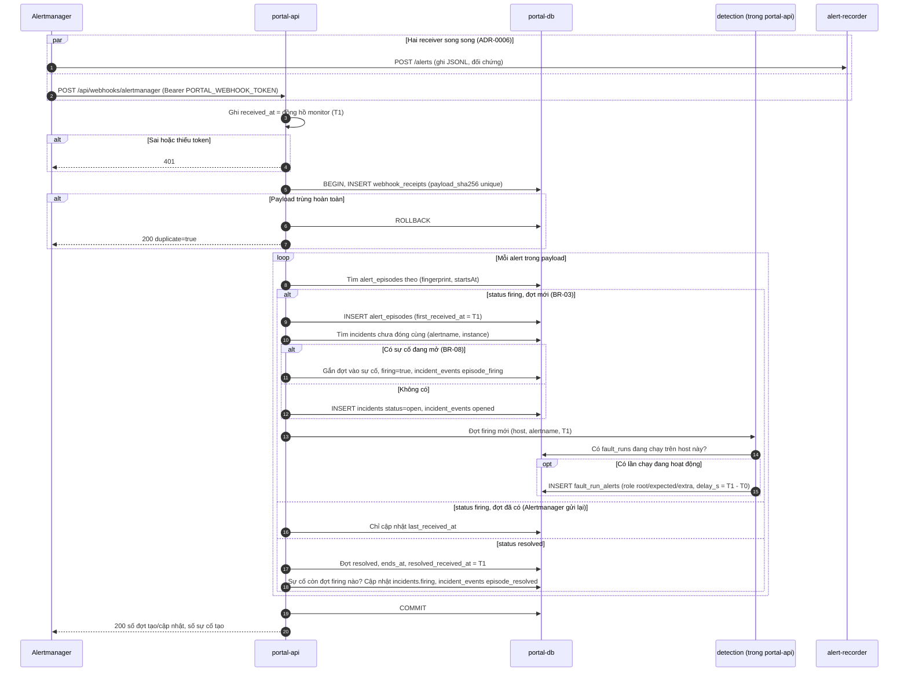
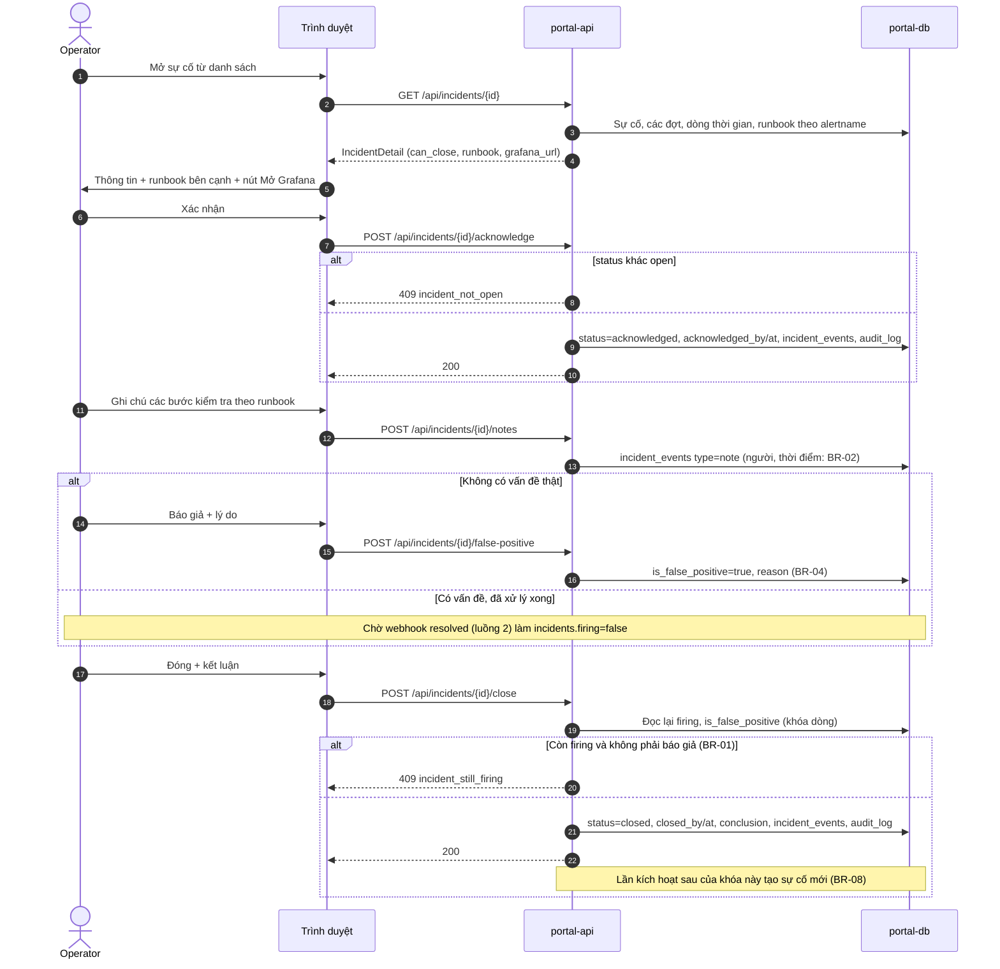
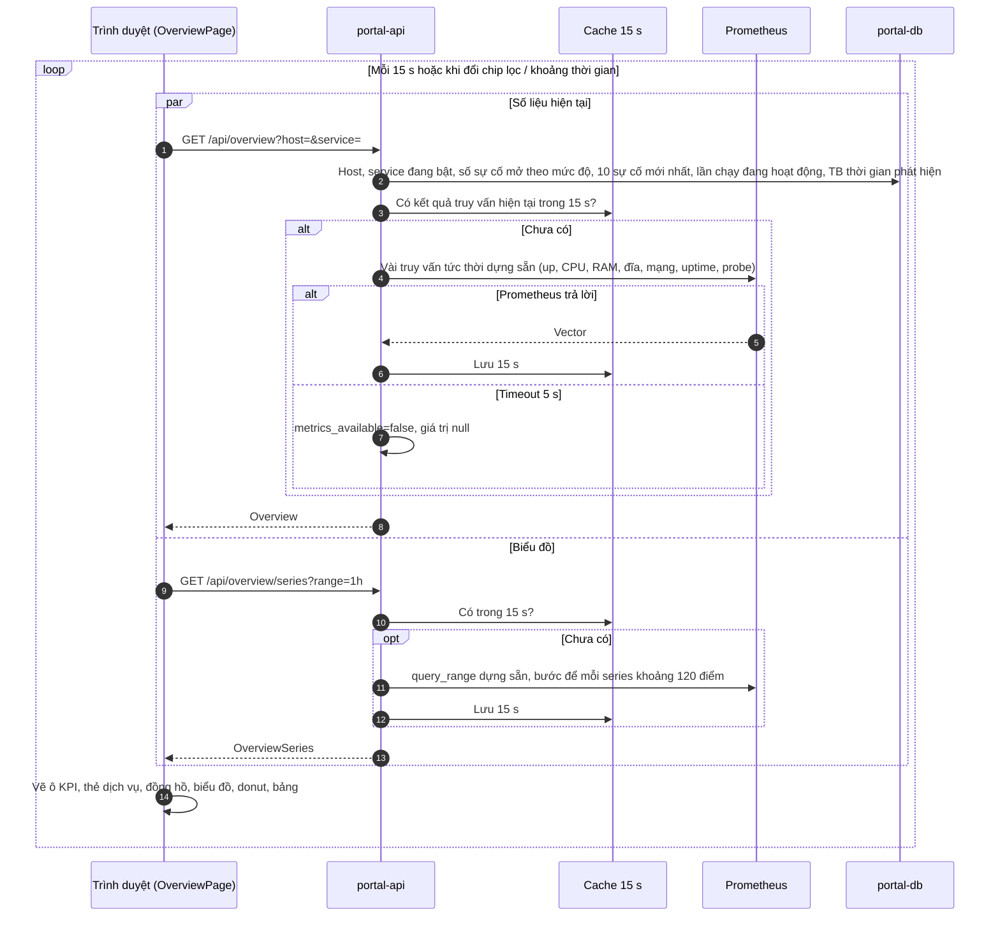
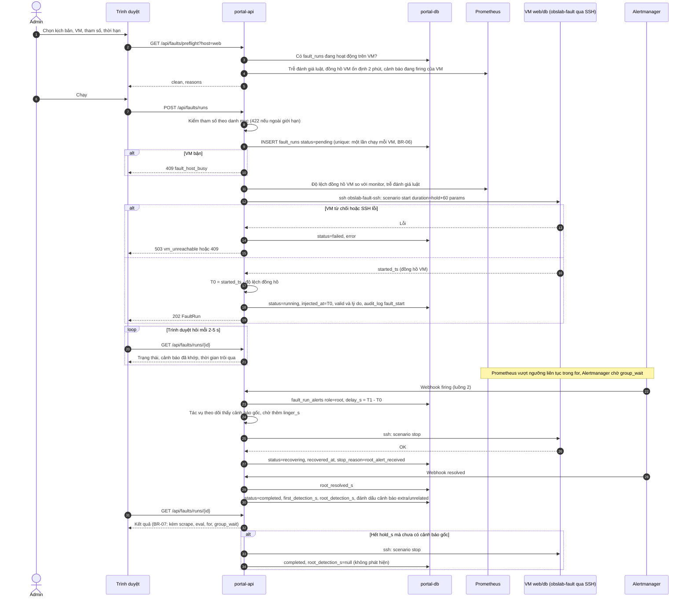
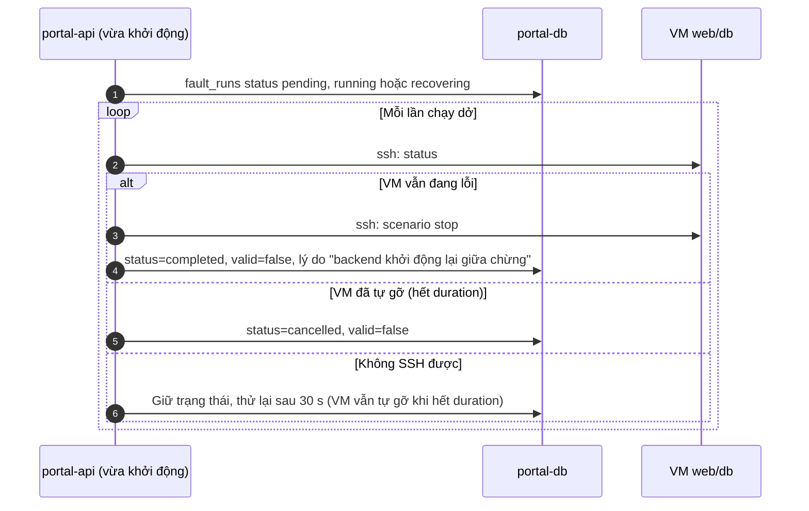

# Sơ đồ tuần tự portal (GĐ4, phần 3)

Các luồng chính giữa trình duyệt, backend (`portal-api`), CSDL (`portal-db`), Prometheus, Alertmanager và VM lab. Tên API
theo [openapi.yaml](api/openapi.yaml); bảng và ràng buộc theo [erd.md](erd.md); quyết định theo [kiến trúc](kien-truc-portal.md).

| # | Luồng | Use case / quy tắc |
|---|---|---|
| 1 | [Đăng nhập và gọi API có phân quyền](#1-đăng-nhập-và-gọi-api-có-phân-quyền) | UC01, FR-P01–02, NFR-02–03 |
| 2 | [Nhận webhook cảnh báo](#2-nhận-webhook-cảnh-báo) | UC12, FR-P08, BR-03, BR-08, NFR-05–06 |
| 3 | [Operator xử lý sự cố](#3-operator-xử-lý-sự-cố) | UC05–UC10, BR-01, BR-02, BR-04 |
| 4 | [Trang tổng quan](#4-trang-tổng-quan) | UC02, UC11, FR-P03 |
| 5 | [Admin chạy kịch bản lỗi và tính thời gian phát hiện](#5-admin-chạy-kịch-bản-lỗi-và-tính-thời-gian-phát-hiện) | UC16–UC17, BR-05–07, NFR-07–08 |
| 6 | [Backend khởi động lại khi đang chạy kịch bản](#6-backend-khởi-động-lại-khi-đang-chạy-kịch-bản) | NFR-07 |

## 1. Đăng nhập và gọi API có phân quyền

Vai trò và trạng thái khóa đọc lại từ CSDL ở **mỗi** request, nên khóa tài khoản hay hạ vai trò có hiệu lực ngay dù JWT còn hạn.

## 2. Nhận webhook cảnh báo

- Hai webhook cùng tới cho một khóa: unique index "một sự cố chưa đóng mỗi `(alertname, instance)`" làm một transaction lỗi;
  transaction đó thử lại một lần và sẽ gắn vào sự cố vừa tạo.
- Lỗi xử lý một alert riêng lẻ được ghi lại nhưng vẫn trả 200, vì payload thô đã lưu và xử lý lại được. Chỉ trả 5xx khi không
  lưu được payload, để Alertmanager gửi lại.

## 3. Operator xử lý sự cố

## 4. Trang tổng quan

Nhiều người mở trang cùng lúc vẫn chỉ tạo mỗi truy vấn một lần mỗi 15 s tới Prometheus.

## 5. Admin chạy kịch bản lỗi và tính thời gian phát hiện

- T0 và T1 cùng đồng hồ monitor (chrony), giống `tools/fault.py` và alert-recorder, nên kết quả portal đối chiếu được với CLI ở GĐ7.
- VM luôn tự gỡ khi hết `duration` (= `hold_s` + 60 s), kể cả khi backend chết giữa chừng (ADR-0007).

## 6. Backend khởi động lại khi đang chạy kịch bản

