# Lộ trình thực hiện

Kế hoạch được lập lại ở **tuần 6/18** sau phản hồi của giảng viên (chuyển từ Docker một máy sang 3 VM + web portal).
Còn **13 tuần (tuần 6 → 18)**. Nguyên tắc: **lõi giám sát + kịch bản lỗi chạy được trước** (đạt tiêu chí nghiệm thu
tối thiểu trước tuần 10), portal làm sau và được phép cắt bớt phạm vi nếu trễ.

Quy trình làm việc: xong mỗi giai đoạn → commit → báo cáo những gì đã làm + cách tự kiểm tra → chờ xác nhận.

## Tổng quan

```mermaid
gantt
  title Lộ trình tuần 6 → 18
  dateFormat  X
  axisFormat  T%s
  section Lõi giám sát
  GĐ0 Khung & phân tích           :g0, 6, 7
  GĐ1 Hạ tầng 3 VM                :g1, 6, 8
  GĐ2 Lõi giám sát                :g2, 7, 9
  GĐ3 Kịch bản lỗi + baseline     :g3, 8, 10
  section Portal
  GĐ4 Thiết kế portal             :g4, 9, 10
  GĐ5 Backend                     :g5, 10, 13
  GĐ6 Frontend                    :g6, 11, 15
  GĐ7 Kịch bản lỗi trong portal   :g7, 14, 16
  section Đánh giá
  GĐ8 Thử nghiệm & báo cáo        :g8, 16, 19
```

## Chi tiết

| GĐ | Tuần | Nội dung | Tiêu chí hoàn thành | Trạng thái |
|---|---|---|---|---|
| 0 | 6 | Tái cấu trúc repo, `.env.example`, ADR, nháp phân tích nghiệp vụ/use case/yêu cầu, lộ trình | Repo theo cấu trúc mới; tài liệu phân tích nháp được nhóm đọc góp ý | **xong** |
| 1 | 6–7 | `Vagrantfile`, `provision/*.sh`: Ubuntu, chrony, ổ `/mnt/labdisk`, Node Exporter; Nginx + demo app (web); PostgreSQL (db); Docker trên monitor | `vagrant destroy -f && vagrant up` dựng sạch; truy cập được web/db từ monitor | **xong** |
| 2 | 7–8 | `monitor/` Compose; nginx-exporter, postgres-exporter; target theo VM; luật cảnh báo cho host/Nginx/PostgreSQL/endpoint; dashboard host, service, nginx, postgres; alert-recorder; runbook nháp | `tools/check_lab.py` báo mọi target UP; Grafana có dữ liệu; cảnh báo thử về alert-recorder | **xong** |
| 3 | 8–9 | `faults/` trên VM, user SSH bị giới hạn; CLI gây lỗi từ Windows; **đo baseline ≥ 24 giờ**, chốt ngưỡng v1; đo thời gian phát hiện | ≥ 3 kịch bản (CPU, disk, service down) có CSV/Markdown kết quả → **đạt tiêu chí nghiệm thu tối thiểu** | **đang làm**: xong phần 1 (kịch bản + SSH giới hạn), phần 2 (CLI), phần 3 (đo phát hiện, [báo cáo](05-thu-nghiem/thoi-gian-phat-hien.md)); chỉnh luật cảnh báo hệ quả (phương án D, đã kiểm chứng `gd3-dot4`); baseline 24 giờ đang đo (2026-11-26 13:53 → 11-27 13:53) |
| 4 | 9 | Thiết kế portal: ERD, API (OpenAPI), sơ đồ tuần tự, wireframe | Giảng viên/mentor duyệt thiết kế | **xong, chờ mentor duyệt**: [bộ thiết kế](02-thiet-ke/README.md) gồm kiến trúc, ERD, API, sơ đồ tuần tự, định hướng giao diện; bỏ wireframe ([ADR-0009](02-thiet-ke/adr/0009-bo-wireframe-gd4.md)) |
| 5 | 10–12 | Backend: đăng nhập JWT + 2 vai trò, CRUD host/service, truy vấn Prometheus, nhận webhook + vòng đời cảnh báo, runbook, kiểm thử | Test API qua; cảnh báo thật xuất hiện trong CSDL portal | **đang làm** (trên Windows, dữ liệu giả): xong phần 1/7 (khung, CSDL); [tiến độ](../portal/backend/README.md#tiến-độ-gđ5) |
| 6 | 11–14 | Frontend: đăng nhập, tổng quan, chi tiết + biểu đồ, cảnh báo/sự cố, runbook, quản lý host/service, người dùng | Operator đi hết luồng xử lý cảnh báo trên UI | |
| 7 | 14–15 | Chạy kịch bản lỗi từ portal (chỉ admin), tự tính thời gian phát hiện, xuất báo cáo, link/nhúng Grafana | Kết quả portal khớp với CLI trong sai số đã nêu | |
| 8 | 16–18 | Chạy lặp các kịch bản, phân tích báo giả, thử yêu cầu phi chức năng, hoàn thiện tài liệu, slide, demo | Đủ bộ tài liệu 5 phần + kịch bản demo | |

## Rủi ro & phương án

| Rủi ro | Ảnh hưởng | Phương án |
|---|---|---|
| VirtualBox xung đột với Hyper-V/WSL2 (Docker Desktop) trên Windows | VM chậm hoặc không khởi động | Tắt Docker Desktop khi chạy lab; dùng VirtualBox 7.2 (đã kiểm thử 7.2.22) + Vagrant 2.4.9; dự phòng: provider Hyper-V của Vagrant |
| Lịch bị nén (13 tuần) | Portal không kịp đủ chức năng | Lõi giám sát + kịch bản lỗi xong trước tuần 10; portal ưu tiên theo mức độ trong [yêu cầu](01-phan-tich/yeu-cau.md) (M trước, S/C sau) |
| Baseline ngắn, không đại diện | Ngưỡng gây báo giả | Đo baseline ≥ 24 giờ có tải nền đều; đo lại sau khi thay đổi hạ tầng |
| Lệch đồng hồ giữa các VM | Sai số thời gian phát hiện | chrony trên mọi VM; portal ghi cả hai mốc bằng cùng một đồng hồ (ADR-0006) |
